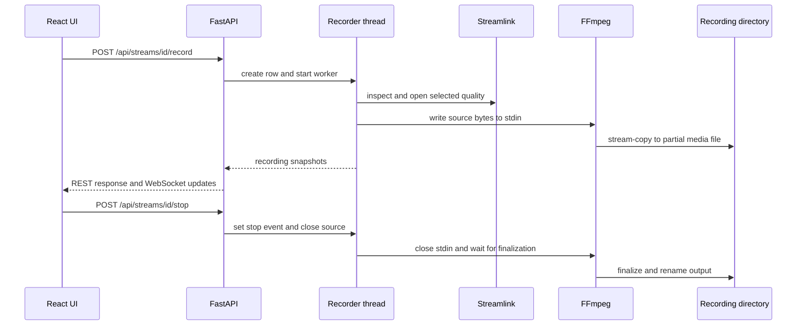

# Recording pipeline

## Start and capture

`POST /api/streams/{stream_id}/record` calls `start_recording()` in `backend/main.py`. It validates the source, prevents a second active recording for the same source, enforces `max_recordings`, inserts a `recordings` row in `starting` state, creates a `Recorder`, stores it in runtime dictionaries, and starts its daemon thread.

`ffmpeg_command()` in `backend/ffmpeg_recorder.py` maps all input streams and uses `-c copy`, so recording does not re-encode. The default output is MKV. Names include a sanitized source name and timestamp. Writes go to hidden `.partial` files first; the worker renames non-empty output after FFmpeg exits. Optional segmented recording uses the FFmpeg segment muxer and then renames partial segments to numbered output files.

## Reconnects and metadata

When Streamlink reads fail or end, `Recorder._run()` records the error, increments `retry_count`, enters `reconnecting`, logs a warning, waits for the configured `retry_seconds`, and opens the source again while retaining the FFmpeg process. The retry loop ends after a stop request or unrecoverable finalization outcome. A probe thread runs FFprobe approximately every eight seconds to refresh resolution and bitrate.

## Stop and recovery

The stop route sets `stop_event`, closes the Streamlink source, and returns `{"ok": true, "state": "finalizing"}`. The worker closes FFmpeg stdin so the muxer can write indexes; it waits, sends SIGINT on timeout, then kills if necessary. Empty outputs are removed. The background task updates the database and emits `recording-finished` after the thread exits.

At backend startup, `recover_interrupted_recordings()` scans rows in transitional states. It attempts to rename partial output files and marks rows `interrupted` when media remains or `error` when no output exists. Recovery is best effort; it does not run FFprobe to repair or validate every recovered container.

## Output ownership and limits

Recording output goes to the configured `recording_dir` (default: `~/.streamx/Recordings`), not to the HLS preview folder. `max_recordings` limits concurrent recording workers; preview and time-shift workers do not count toward that setting. Deletion refuses active/transitional recordings and removes files associated with the selected history row.

## Known limitations

- Stream-copy preserves source codecs and may produce files that a particular playback client cannot decode.
- A reconnect continues writing into the current FFmpeg session; continuity and timestamp behavior depend on the source and codec after reconnect.
- MP4 index finalization occurs at stop, so an abruptly interrupted MP4 may be less recoverable than MKV.
- No explicit per-recording disk quota is enforced. The `low_disk_gb` setting reports a warning metric; it does not stop a recording.
