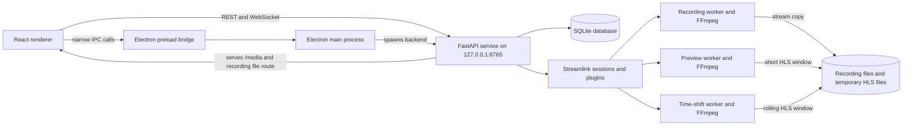

# System overview

StreamX Studio is a desktop application with an Electron shell, a React/TypeScript renderer, and a loopback FastAPI service. The backend uses Streamlink to resolve/read a source, FFmpeg for recording or HLS output, SQLite for configuration/history/logs, and optional `psutil` for machine metrics.

## Runtime boundaries

- `electron/main.cjs` starts `python -m uvicorn backend.main:app` bound to `127.0.0.1:8765`, waits for `/health`, and opens the renderer. Development mode loads Vite from `127.0.0.1:5173`; production mode loads `dist/index.html`.
- `electron/preload.cjs` exposes only `openBrowser`, `openPath`, and `getApiToken` through `window.streamx`. Node integration is disabled in the main window.
- `src/App.tsx` calls the backend using REST and WebSocket. It also refreshes REST data every 2.5 seconds.
- `backend/main.py` owns HTTP routes, runtime managers, background monitoring, and WebSocket event fan-out.
- Recording, preview, and time-shift each read their own Streamlink stream and feed a separate FFmpeg process. They do not share one capture buffer.

## Data flow

1. A source is saved in SQLite as a URL and capture preference. Probing or monitoring calls Streamlink's Python API to discover playable qualities.
2. A user action or monitor rule starts `Recorder`, `Preview`, or `TimeShiftCapture` in a Python thread. That component opens a Streamlink stream and writes bytes to FFmpeg stdin.
3. The recorder writes finalized media files in the configured recording directory. Preview and time-shift write temporary HLS playlists and segments under `data_dir()/media`.
4. The UI gets configuration and snapshots through `/api/*`. The backend serves local HLS files from `/media/*` and recordings from `/api/recordings/{id}/file`.
5. SQLite stores source definitions, settings, recording history, and logs. Active worker state and availability state are memory-only.

## Access boundary

Electron supplies a random per-launch token to the backend. When `STREAMX_TOKEN` is set, ordinary HTTP API requests use `X-StreamX-Token`, the recording file route accepts a `token` query parameter, and `/ws` checks a query parameter. `/health`, FastAPI documentation routes, and `/media/*` are exempted by the HTTP middleware. The service is intended to bind to loopback; it is not designed as a network-facing server. If the backend is run without `STREAMX_TOKEN`, middleware authentication is not enabled.

## Runtime dependencies

`requirements.txt` constrains FastAPI (`>=0.115,<1`), Uvicorn (`>=0.34,<1`), Streamlink (`8.6.3`), and `psutil` (`>=6,<8`). `package.json` uses React/React DOM 19, HLS.js `^1.6.13`, Electron `^45.2.3`, Vite `^6`, and TypeScript `~5.7.2` (plus Lucide icons and build tooling). FFmpeg and FFprobe are external system binaries and must be on `PATH`; setup checks for them but does not install or package them.
